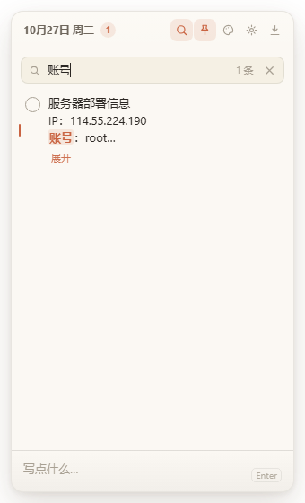
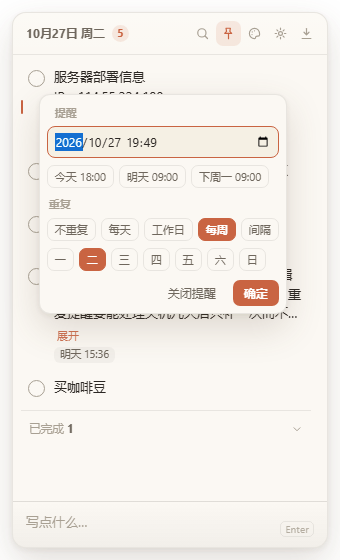
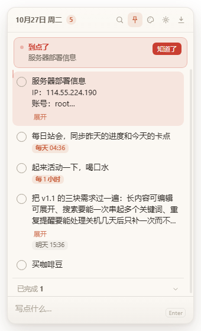
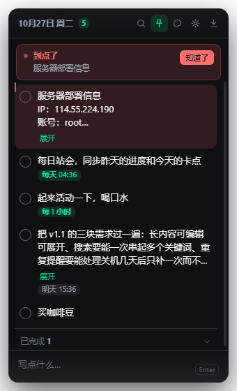

# StickyTodo · 桌面待办便签

一个常驻 Windows 桌面的迷你待办便签。无边框、半透明、随手记、随手勾，数据只存本地。

> 需求与验收标准见 [`docs/需求提示词.md`](docs/需求提示词.md)

## 下载

到 [Releases](https://github.com/xiacongming/desktop-todo/releases/latest) 下载即可，不需要装 Node：

| 文件 | 说明 |
|---|---|
| `StickyTodo-Setup-<版本>.exe` | 安装版，可选安装目录，自动创建桌面快捷方式（推荐） |
| `StickyTodo-<版本>.exe` | 免安装版，双击即用 |

> 安装包没有代码签名，首次运行 Windows 会弹 SmartScreen 提示，点「更多信息 → 仍要运行」。

## 界面

| 纸感米白 | 磨砂深色 |
|---|---|
|  |  |

| 淡蓝极简 | 暖黄便签 | 高对比暗黑 |
|---|---|---|
|  |  |  |

| 搜索（多关键词 + 高亮） | 提醒（截止时间 + 重复规则） |
|---|---|
|  |  |

到点时的横幅，浅色与深色皮肤各一张：

| 纸感米白 | 高对比暗黑 |
|---|---|
|  |  |

## 启动

**方式一**：双击 `启动待办.bat`

**方式二**：

```bash
npm install     # 首次
npm run dev
```

> 若 `npm install` 后 `node_modules/electron/dist` 为空（Electron 二进制没下载成功），
> 用国内镜像手动补：下载 `https://npmmirror.com/mirrors/electron/<版本>/electron-v<版本>-win32-x64.zip`
> 解压到 `node_modules/electron/dist`，再写入 `node_modules/electron/path.txt` 内容为 `electron.exe`。

```bash
npm test        # 42 项自测（数据层 10 + 重复规则 8 + 渲染层 24）
npm run build   # 打包 Windows 安装包 + 免安装版，产物在 dist/
```

## 怎么用

| 操作 | 方式 |
|---|---|
| 新增待办 | 底部输入框输入，`Enter` 提交，`Shift + Enter` 换行（中文输入法下回车不会误提交） |
| 输入框放大 | 拖动输入框上边缘的横条调高度（会记住）；双击那条横条在「紧凑 / 大输入」之间切换 |
| 完成待办 | 点左侧圆圈，条目下沉到「已完成」区 |
| 撤销完成 | 再点一次圆圈，回到它原来的排序位置 |
| 修改文字 | 悬停 → 铅笔，或双击正文；`Enter` 保存 / `Shift + Enter` 换行 / `Esc` 取消；改成空内容即删除（可撤销） |
| 查看长内容 | 超过 3 行的条目下方有「展开」，展开后状态在重渲染、滚动、切换皮肤时都不会丢 |
| 搜索 | 顶部放大镜或 `Ctrl + F`，输入即筛，空格分隔多个关键词（全部命中才算）；命中处高亮，已完成项也参与 |
| 排序 | 按住条目直接拖；置顶区与普通区不能互拖；搜索状态下不可拖（顺序已无意义） |
| 单条置顶 | 悬停 → 图钉 |
| 提醒 | 悬停 → 时钟，选时间后可加重复规则：不重复 / 每天 / 工作日 / 每周几 / 每 N 分钟 |
| 关闭某条提醒 | 提醒浮层里点「关闭提醒」，勾选完成也会让提醒停止 |
| 删除 | 悬停 → 垃圾桶，5 秒内可撤销 |
| 撤销删除 | `Ctrl + Z`，或点提示条上的「撤销」 |
| 确认提醒 | 到点后顶部出现横幅，点「知道了」收起；点之前对应条目一直高亮 |
| 显示 / 隐藏 | 单击托盘图标，或 `Ctrl + Alt + T` |
| 切换皮肤 | 顶部调色板图标 |
| 收起到托盘 | 顶部向下箭头（窗口的关闭不会退出程序，托盘菜单里的「退出」才是真退出） |

## 到点是怎么提醒的

**三条通道同时走**，任何一条都可能被环境吞掉，所以不押在单条上：

1. **Windows 系统通知** —— 右下角弹出、进通知中心、带提示音，点一下把窗口拉到前面。窗口收在托盘里也会响。
2. **托盘图标闪烁** —— 正常图标与红色感叹号图标每 0.7 秒交替一次，最多闪 40 秒。窗口是 `skipTaskbar`，任务栏上没有按钮可闪，托盘是它唯一常驻的入口。
3. **窗口内横幅** —— 顶部一条红底提示，列出到点的待办（超过 3 项显示「等 N 项」），对应条目左侧亮起红竖条并保持高亮，直到你点「知道了」。

几点需要知道：

- **精度是 20 秒**。主进程每 20 秒扫一次，所以「9:00」的提醒可能 9:00:20 才响。
- **应用必须在运行**。收起到托盘没问题，托盘菜单点「退出」、或关机了就不会响。
- **Windows 专注助手会拦通知**。开了勿扰模式时通知会静默进通知中心，这时靠托盘闪烁和窗口横幅兜底。
- **不是真闹钟**：响一次就结束，没有持续响铃，也没有「贪睡 5 分钟」。

重复提醒的规则是：触发后自动把 `dueAt` 推到下一次，所以不会重复弹；
应用没运行期间错过的多次提醒只补发一次，并注明跳过了几次，不会开机弹一串。

## 数据

```
%APPDATA%\StickyTodo\todos.json       当前数据（version 2）
%APPDATA%\StickyTodo\todos.bak.json   上一版备份
```

设置面板与托盘菜单都有「打开数据文件夹」。

**写入策略**：临时文件 → `fsync` → `rename` 原子替换，断电不会产生半个 JSON；每次写入前把上一版留存为 `.bak`；主文件损坏自动读备份，备份也坏则以空数据启动并明确提示，原文件不删。

> **这个文件是明文，没有加密。** 记账号可以，别把真正重要的密码只存在这里——
> 需要密码管理就用密码管理器，这里更适合记「账号是什么、密码在哪」。
> v1 的数据会在首次启动时自动升级到 v2，`remindedAt` 迁移为 `firedAt`，旧字段保留以便回退。

## 结构

```
src/
  main/
    main.js          主进程：窗口、托盘、通知、快捷键、IPC、位置持久化
    store.js         数据层：归一化、原子写入、备份、容错、v1→v2 迁移
    recurrence.js    重复规则纯函数：下一次时间推算、文案、脏数据归一化
    windowState.js   窗口位置校验（拔掉副屏后不会跑到屏幕外）
  preload/
    preload.js       白名单 IPC，contextIsolation 开启，不开 nodeIntegration
  renderer/
    index.html       结构
    styles.css       5 套皮肤全部走 CSS 变量，无写死颜色
    renderer.js      交互逻辑，纯原生无框架
scripts/gen-icons.js 纯 Node 生成图标（手写 PNG 编码，零图形库依赖）
scripts/afterPack.js 打包后裁剪语言包，只留 zh-CN
scripts/capture.bat  一键导出全部界面截图
test/
  store.test.js       数据层：损坏恢复 / 并发写入 / 脏数据归一化 / v1→v2 迁移
  recurrence.test.js  重复规则：跨年、闰年、周末跳过、跨零点、五年空档
  renderer.test.js    渲染层：jsdom 跑真实交互，验证 DOM 结果
docs/screens/         各皮肤真实渲染截图 + 搜索 / 提醒 / 到点横幅
```

## 开发时改样式怎么看效果

```bash
scripts\capture.bat
# 依次切 5 套皮肤，再自动打开搜索条、提醒浮层、到点横幅，把真实窗口渲染结果导出到 docs/screens/
# 用的是独立数据目录（%TEMP%\sticky-shot-ud），不会碰你的真实待办
```

## 体积为什么有一百多兆

解压后 309MB，其中**业务代码只有 72KB**（`resources/app.asar`），其余全是 Electron 自带的 Chromium + Node 运行时：

| 项目 | 大小 |
|---|---|
| `StickyTodo.exe`（内含 Chromium/Node/V8） | 239 MB |
| `dxcompiler.dll` + `d3dcompiler_47.dll` + `ffmpeg.dll` | 33 MB |
| `resources.pak` + `icudtl.dat` | 24 MB |
| `vk_swiftshader.dll` + `vulkan-1.dll` | 6 MB |
| `locales/`（已裁到只剩中文） | 0.6 MB |

这也解释了 VS Code、Discord、Slack 都是 80–120MB。想要 5MB 级别的体积只能换 Tauri（改用系统 WebView2），代价是主进程要用 Rust 重写。

## 已知取舍

- **「磨砂玻璃」是半透明染色，不是真磨砂。** Windows 的透明窗口无法对桌面内容做 backdrop blur。要真磨砂得用 `backgroundMaterial: 'acrylic'`，但那样窗口就不能圆角透明，整体反而更粗糙。
- **任务栏不显示图标**，常驻托盘，避免占用任务栏位置。副作用是 `flashFrame` 无效，所以提醒改成闪托盘图标。
- **已完成区默认折叠。** 折叠时勾选会自动展开一次让你看见它去哪了；你手动收起过后就不再自动展开。
- **开发模式下系统通知可能不弹**（Windows 需要已注册的 AppUserModelID），此时靠托盘闪烁与窗口横幅兜底；打包安装后通知正常。
- **单条上限 500 字**，列表默认显示 3 行，超出点「展开」。
- **重复规则触发后才推进时间**，没有「已提醒过」这种一次性标记，所以同一时刻不会连弹两次。
- **搜索是纯文本包含匹配**，不做拼音、模糊纠错。200 条以内够用，再加就是过度设计。
- **不是密码管理器。** 待办存在本地 JSON 里，明文可读。放 Wi-Fi 密码、服务器账号是够用的，但别当成 1Password。
