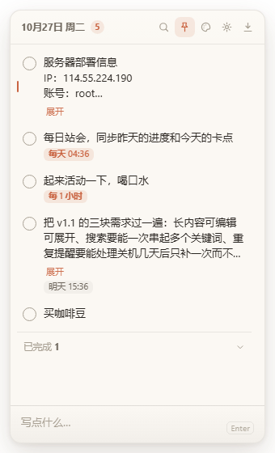
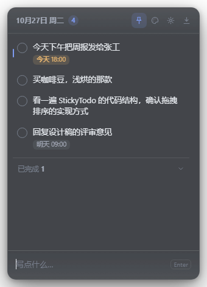
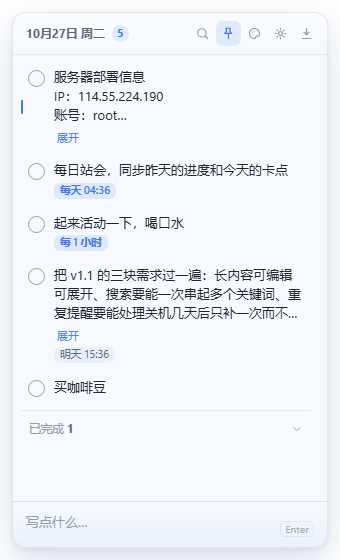
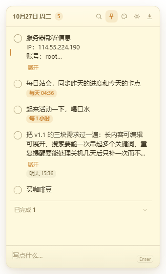
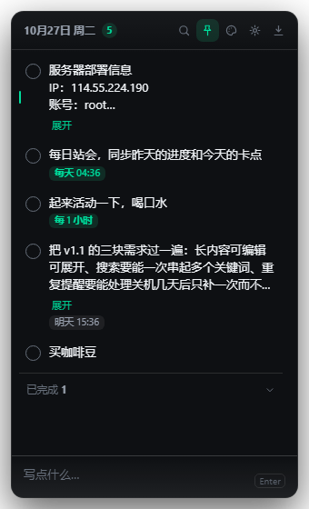

# StickyTodo · 桌面待办便签

一个常驻 Windows 桌面的迷你待办便签。无边框、半透明、随手记、随手勾，数据只存本地。

> 需求与验收标准见 [`docs/需求提示词.md`](docs/需求提示词.md)

## 下载

到 [Releases](https://github.com/xiacongming/desktop-todo/releases/latest) 下载即可，不需要装 Node：

| 文件 | 说明 |
|---|---|
| `StickyTodo-Setup-1.0.0.exe` | 安装版，可选安装目录，自动创建桌面快捷方式（推荐） |
| `StickyTodo-1.0.0.exe` | 免安装版，双击即用 |

> 安装包没有代码签名，首次运行 Windows 会弹 SmartScreen 提示，点「更多信息 → 仍要运行」。

## 界面

| 纸感米白 | 磨砂深色 |
|---|---|
|  |  |

| 淡蓝极简 | 暖黄便签 | 高对比暗黑 |
|---|---|---|
|  |  |  |

## 启动

**方式一**：双击 `启动待办.bat`

**方式二**：

```bash
npm install     # 首次
npm run dev
```

> 若 `npm install` 后 `node_modules/electron/dist` 为空（Electron 二进制没下载成功），
> 用国内镜像手动补：下载 `https://npmmirror.com/mirrors/electron/<版本>/electron-v<版本>-win32-x64.zip`
> 解压到 `node_modules/electron/dist`，再写入 `node_modules/electron/path.txt` 内容为 `electron.exe`。

```bash
npm test        # 20 项自测（数据层 7 + 渲染层 13）
npm run build   # 打包 Windows 安装包 + 免安装版，产物在 release/
```

## 怎么用

| 操作 | 方式 |
|---|---|
| 新增待办 | 底部输入框输入，`Enter` 提交，可连续输入（中文输入法下回车不会误提交） |
| 完成待办 | 点左侧圆圈，条目下沉到「已完成」区 |
| 撤销完成 | 再点一次圆圈，回到它原来的排序位置 |
| 修改文字 | 双击待办文字，`Enter` 保存 / `Esc` 取消；改成空内容即删除 |
| 排序 | 按住条目直接拖；置顶区与普通区不能互拖 |
| 单条置顶 | 悬停 → 图钉 |
| 截止时间 | 悬停 → 时钟，可手选或用「今天 18:00 / 明天 09:00 / 下周一 09:00」快捷项 |
| 删除 | 悬停 → 垃圾桶，5 秒内可撤销 |
| 撤销删除 | `Ctrl + Z`，或点提示条上的「撤销」 |
| 显示 / 隐藏 | 单击托盘图标，或 `Ctrl + Alt + T` |
| 切换皮肤 | 顶部调色板图标 |
| 收起到托盘 | 顶部向下箭头（窗口的关闭不会退出程序，托盘菜单里的「退出」才是真退出） |

到点提醒走 Windows 系统通知；应用没运行期间错过的提醒，启动后会合并成一条汇总通知，不会开机弹一堆。

## 数据

```
%APPDATA%\StickyTodo\todos.json       当前数据
%APPDATA%\StickyTodo\todos.bak.json   上一版备份
```

设置面板与托盘菜单都有「打开数据文件夹」。

**写入策略**：临时文件 → `fsync` → `rename` 原子替换，断电不会产生半个 JSON；每次写入前把上一版留存为 `.bak`；主文件损坏自动读备份，备份也坏则以空数据启动并明确提示，原文件不删。

## 结构

```
src/
  main/
    main.js          主进程：窗口、托盘、通知、快捷键、IPC、位置持久化
    store.js         数据层：归一化、原子写入、备份、容错
    windowState.js   窗口位置校验（拔掉副屏后不会跑到屏幕外）
  preload/
    preload.js       白名单 IPC，contextIsolation 开启，不开 nodeIntegration
  renderer/
    index.html       结构
    styles.css       5 套皮肤全部走 CSS 变量，无写死颜色
    renderer.js      交互逻辑，纯原生无框架
scripts/gen-icons.js 纯 Node 生成图标（手写 PNG 编码，零图形库依赖）
test/
  store.test.js      数据层：损坏恢复 / 并发写入 / 脏数据归一化
  renderer.test.js   渲染层：jsdom 跑真实交互，验证 DOM 结果
docs/screens/        各皮肤真实渲染截图
```

## 开发时改样式怎么看效果

```bash
# 依次切 5 套皮肤，把真实窗口渲染结果导出到 docs/screens/
set STICKY_SHOTS=docs/screens && node_modules\electron\dist\electron.exe .
```

## 已知取舍

- **「磨砂玻璃」是半透明染色，不是真磨砂。** Windows 的透明窗口无法对桌面内容做 backdrop blur。要真磨砂得用 `backgroundMaterial: 'acrylic'`，但那样窗口就不能圆角透明，整体反而更粗糙。
- **任务栏不显示图标**，常驻托盘，避免占用任务栏位置。
- **已完成区默认折叠。** 折叠时勾选会自动展开一次让你看见它去哪了；你手动收起过后就不再自动展开。
- **开发模式下系统通知可能不弹**（Windows 需要已注册的 AppUserModelID），代码里加了「窗口边框闪烁」兜底；打包安装后通知正常。
- 单条上限 500 字，列表最多显示 3 行，超出部分截断（悬停查看全文的 tooltip 尚未实现）。
